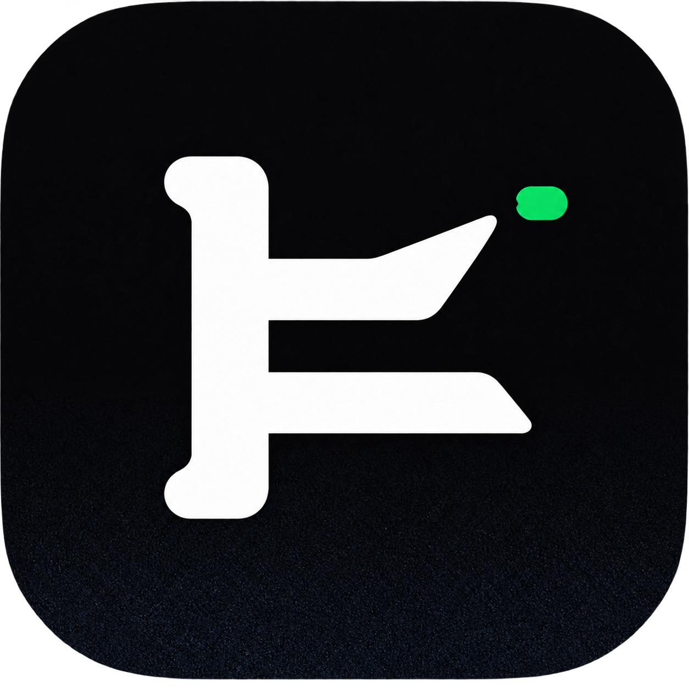

<div align="center">



# KimiSwitch

**Kimi Code quota exhausted? Keep working — switch to another account in one click.**

KimiSwitch is a desktop app that pools your authorized Kimi Code API keys behind a local proxy
and fails over automatically when an account runs out of quota, hits a rate limit, or stops responding.

**[Download for macOS & Windows](https://github.com/kyui-azusa/kimi-switch/releases/latest)** · [简体中文](README.zh-CN.md)

[](https://github.com/kyui-azusa/kimi-switch/releases/latest)
[](https://github.com/kyui-azusa/kimi-switch/releases)
[](LICENSE)
[](https://github.com/kyui-azusa/kimi-switch/releases/latest)

<!-- TODO: add docs/screenshot.png — a capture of the account list and usage page -->

</div>

## Why KimiSwitch

Kimi Code limits each account in five-hour and weekly windows. When your current account hits
the limit, the usual fix is to edit `~/.kimi-code/config.toml` by hand, paste in another key, and
restart your session. KimiSwitch automates that whole routine:

- **One-click account switching** — import your existing Kimi providers and switch the active account from a desktop UI.
- **Automatic failover when quota runs out** — with rotation enabled, an exhausted, rate-limited, or failing account is swapped for a healthy one, and the request is retried in place so your Kimi Code session keeps going.
- **Honest quota handling** — KimiSwitch never scrapes undocumented quota pages, never spoofs the client identity, and never claims that locally observed usage equals an account's remaining quota.

## Features

- Runs a loopback proxy on `127.0.0.1:15722` (avoiding CC Switch's default `15721`).
- Keeps Kimi API keys in environment variables or the OS credential store (macOS Keychain / Windows Credential Manager) — never in command-line arguments.
- Manual active-key switching, plus an optional automatic rotation mode:
  - `sticky`: keeps using the current key and only fails over when quota is exhausted, authentication fails, rate limits hit, or the upstream becomes unavailable.
- Retries a request on an upstream 401, 403, 429, or 5xx response only when rotation is enabled and no successful stream has started. A short upstream 429 is re-sent inside the same HTTP request so the original Kimi Code session continues.
- Classifies observed failures as exhausted quota, temporary rate limit, invalid key, disabled account, network failure, or upstream failure. Network errors never poison account health.
- Quarantines failed accounts for at least 10 minutes. Healthy accounts are always preferred.
- Per-account availability checks use a one-output-token completion, so an authentication-only success cannot hide an exhausted quota.
- Records per-key and per-day request, success, error, input, output, cache-read, reasoning, observed-total, and estimated-token statistics, with 7/30-day trends.
- Manages the Kimi Code direct/KimiSwitch takeover switch: takeover changes only model-provider routing in `~/.kimi-code/config.toml`, preserves the original provider, creates `~/.kimi-code/config.toml.kimiswitch.bak`, and restores direct mode atomically.
- Keeps running in the system tray when the window is closed; updates itself in-app via signed releases.

## Download

Grab the installer from the [latest release](https://github.com/kyui-azusa/kimi-switch/releases/latest):

| Platform | Installer |
| --- | --- |
| macOS Apple Silicon | `KimiSwitch_<version>_darwin-aarch64.dmg` |
| macOS Intel | `KimiSwitch_<version>_darwin-x86_64.dmg` |
| Windows x64 | `KimiSwitch_<version>_windows-x86_64-setup.exe` |

After the first manual install, later releases update in-app from the settings page.
Release history lives in [CHANGELOG.md](CHANGELOG.md).

## Quick start

1. Launch KimiSwitch — it starts a local proxy on `127.0.0.1:15722`.
2. Click **Import** to read `api_key` values from your existing `~/.kimi-code/config.toml` into the OS credential store. Import is read-only; OAuth-only providers are skipped.
3. Turn on **KimiSwitch takeover**. Your models now route through the local proxy; the original provider block is preserved and a one-time backup is written. Run `/reload` in an already-running Kimi Code session.
4. Optionally enable **automatic rotation** (`sticky` mode). When the active account stops working, KimiSwitch fails over to the next healthy account and retries the request.

To go back, flip the takeover switch off — the original provider references are restored.

## How it compares

| | Editing `config.toml` by hand | [CC Switch](https://github.com/farion1231/cc-switch) | KimiSwitch |
| --- | --- | --- | --- |
| Switch the active Kimi account | Edit file, restart session | One click | One click |
| Automatic failover when quota is exhausted | No | No | Yes, with in-place retry |
| Quota-exhaustion vs. rate-limit classification | No | No | Yes |
| Per-account token usage stats for Kimi | No | No | Yes (input / output / cache-read / reasoning) |
| Key storage | Plain text in config | Plain text in config | OS credential store or env vars |
| In-app signed auto-update | — | Yes | Yes, with a fallback update source |

KimiSwitch's desktop information architecture, visual tokens, and selected UI wrappers are adapted
from CC Switch under the MIT License — see [THIRD_PARTY_NOTICES.md](THIRD_PARTY_NOTICES.md). The
multi-account pooling, failover proxy, and Kimi-specific usage accounting are original work.

## What KimiSwitch does NOT do

- It does not create quota. It rotates among **your own authorized accounts**; each account keeps its own plan limits.
- It does not scrape undocumented quota pages or unofficial endpoints.
- It does not spoof the client identity or modify requests beyond swapping the API key.
- It does not treat locally observed usage as an account's remaining quota. Manually recorded refresh times are displayed as `手动参考 · 非官方` and never drive rotation, health, or quota decisions.

KimiSwitch is for personal or authorized internal use and is not affiliated with Moonshot AI, Kimi, or the CC Switch project.

## FAQ

**Will switching accounts break my running Kimi Code session?**
No. Takeover only changes provider routing in `config.toml`. Run `/reload` in a live session (new sessions pick it up directly). When rotation fails over mid-request, the proxy re-sends the request on the new account within the same HTTP connection when possible.

**Where are my API keys stored?**
In environment variables or the OS credential store (macOS Keychain / Windows Credential Manager). Keys never appear in command-line arguments. The proxy keeps request bodies in memory only while forwarding; persistent state contains metadata and usage counters, not prompts or responses.

**Does it work on Windows?**
Yes — macOS (Apple Silicon and Intel) and Windows x64 installers are published for every release.

**What happens if all accounts are limited?**
The proxy returns the original upstream error instead of retrying forever. Cooled-down accounts are only retried when no healthy enabled account remains.

**How do I update?**
From the settings page — the app checks a signed update manifest, verifies the minisign signature, downloads, installs, and restarts. The primary update source is a static server with the GitHub release as automatic fallback.

## Development

Requires Node 22, pnpm, Go 1.24, and a Rust toolchain.

```sh
cd kimi-switch
pnpm install
pnpm tauri:dev
```

The Tauri app builds and starts the Go proxy as a bundled sidecar. The CLI remains available for scripting:

```sh
go run ./cmd/kimi-switch init
go run ./cmd/kimi-switch add work --env KIMI_WORK_KEY
export KIMI_WORK_KEY='your-work-key'
go run ./cmd/kimi-switch rotation on sticky
go run ./cmd/kimi-switch serve
```

Admin endpoints (all behind the local proxy bearer key, default `local-kimi-switch`):

```text
GET  /healthz
GET  /api/status
GET  /api/usage
PUT  /api/kimi/takeover          {"enabled":true}
POST /api/rotation              {"enabled":true,"mode":"sticky"}
POST /api/keys/<name>/use
POST /api/keys/<name>/test
```

Verification:

```sh
go test ./...
go vet ./...
pnpm test:update-manifest
```

## Documentation

- [docs/README.md](docs/README.md) — behavior and design decisions
- [docs/updates.md](docs/updates.md) — updater signing, dual update sources, release-server deployment, and rollback
- [docs/account-health.md](docs/account-health.md) — failure classification and cooldown rules
- [docs/takeover-recovery.md](docs/takeover-recovery.md) — takeover state recovery
- [CHANGELOG.md](CHANGELOG.md) — release history

## License

KimiSwitch is released under the [MIT License](LICENSE). The CC Switch project is a separate
project with its own license and attribution requirements; see [THIRD_PARTY_NOTICES.md](THIRD_PARTY_NOTICES.md).
